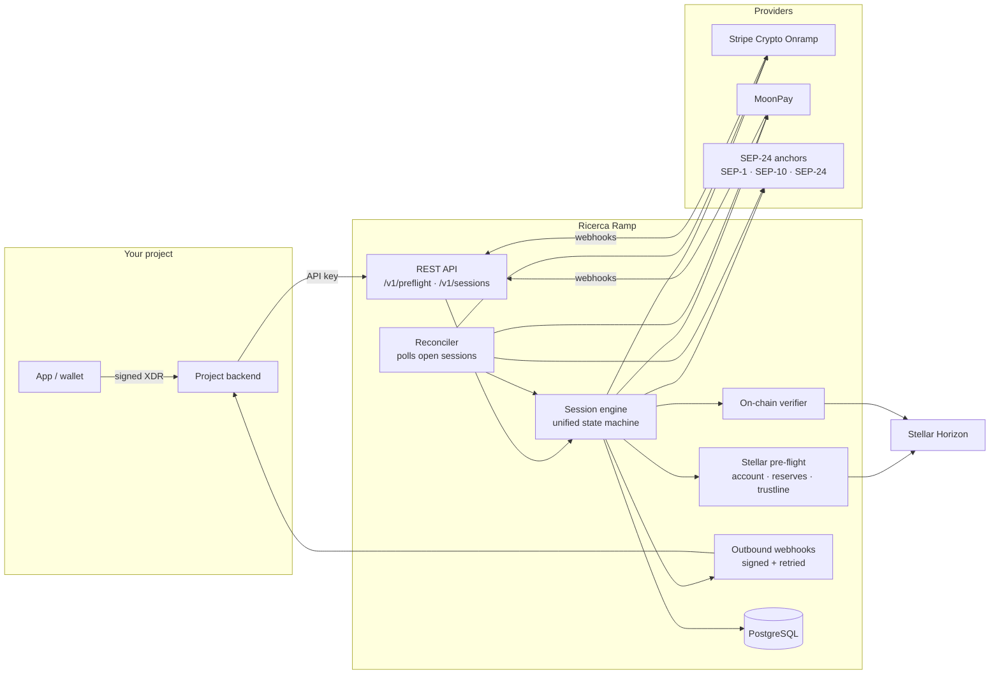
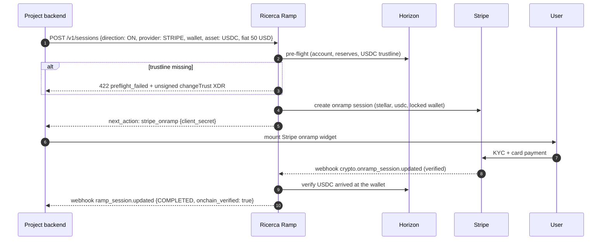
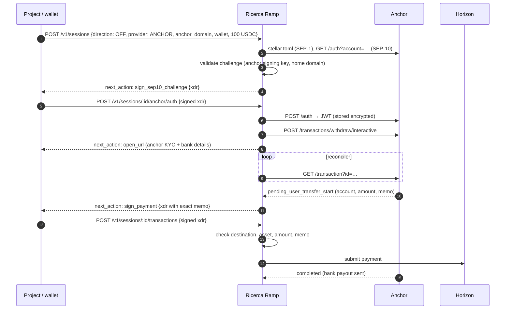
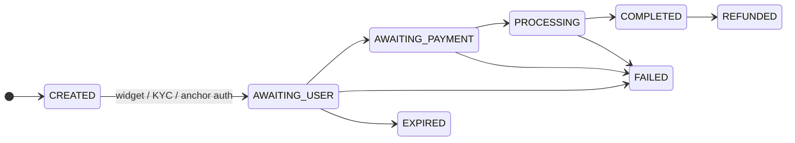
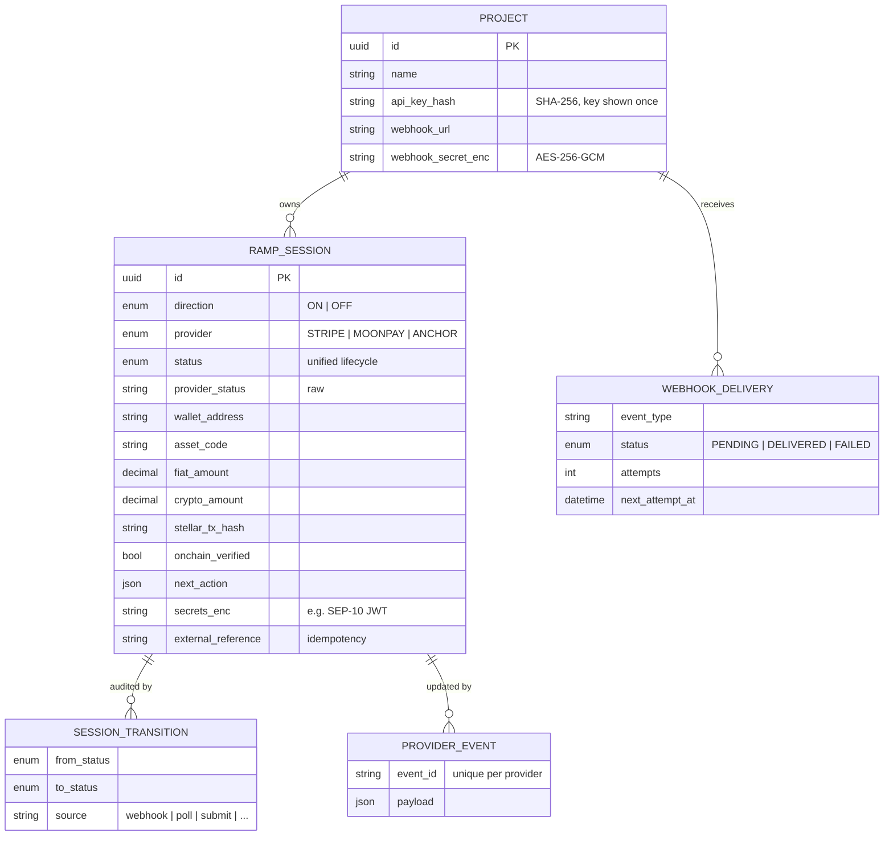

# Ricerca Ramp

**Non-custodial on/off-ramp infrastructure for projects building on Stellar.**

Ricerca Ramp gives a project one API for moving users between fiat and USDC/XLM
on Stellar, across several ramp providers, and fixes the problems that make
ramps fail in production: missing trustlines, wrong memos, stuck statuses,
lost webhooks and "completed" deliveries that never arrived.

> Status: **initial scaffold.** The Stellar checks, provider adapters and data
> model are in place and the setup scripts work against testnet. The session
> API, webhook ingestion and reconciler are specified below and tracked in the
> [roadmap](#roadmap).

---

## Contents

- [Why](#why)
- [What it does](#what-it-does)
- [Providers](#providers)
- [Architecture](#architecture)
- [Flows](#flows)
- [Unified session status](#unified-session-status)
- [API design](#api-design)
- [Data model](#data-model)
- [Security](#security)
- [Getting started](#getting-started)
- [Scripts](#scripts)
- [Configuration](#configuration)
- [Repository layout](#repository-layout)
- [Roadmap](#roadmap)
- [Compliance note](#compliance-note)

---

## Why

Every project that touches real money on Stellar rebuilds the same fragile
integration, and hits the same failures:

| Failure | What happens | How Ricerca Ramp handles it |
|---|---|---|
| **No USDC trustline** | The user pays by card, but USDC can't be delivered; the anchor parks it or the onramp fails. | Pre-flight detects it and returns an unsigned `changeTrust` transaction for the wallet to sign **before** payment. |
| **Unfunded account / XLM stuck in reserves** | The account can't hold the trustline or pay fees. | Pre-flight computes the real minimum balance (base reserve × subentries, sponsorships) and reports the shortfall. |
| **Wrong or missing memo on off-ramp** | Funds reach the anchor's pooled account but can't be matched to the user. | The service builds the exact payment (destination, asset, amount, memo) and **refuses to submit** a signed payment that differs. |
| **Status stuck at "pending"** | A webhook was missed and the user never sees completion. | Every session is also polled by a reconciler; the provider's current state wins. |
| **Out-of-order webhooks** | A late "pending" overwrites "completed". | One state machine: webhooks can't move a session backwards, and finished sessions stay finished. |
| **"Completed" but nothing arrived** | Provider says done; the wallet disagrees. | Deliveries are independently verified on Stellar (transaction, destination, asset, amount, memo). |
| **Five providers, five status vocabularies** | Every project maps statuses by hand. | Stripe, MoonPay and SEP-24 statuses map to one lifecycle. |

## What it does

- **One API over several providers:** Stripe Crypto Onramp, SEP-24 anchors and MoonPay.
- **Non-custodial:** it never holds user keys. Wallets sign the SEP-10 challenge, trustlines and withdraw payments; the service builds and checks them.
- **Pre-flight wallet checks** before any money moves.
- **Anchor safety:** it only contacts allow-listed anchors, validates SEP-10 challenges before a wallet signs them, and checks memos on withdrawals.
- **On-chain verification** of every delivery via Horizon, including claimable balances.
- **Verified inbound webhooks** (Stripe and MoonPay signatures, timestamp tolerance, deduplication).
- **Signed outbound webhooks** to each project's backend, with retries.
- **Multi-tenant:** each project gets an API key, a webhook endpoint and its own sessions.

## Providers

| Provider | On-ramp | Off-ramp | Assets | Fiat | Integration |
|---|:-:|:-:|---|---|---|
| **Stripe Crypto Onramp** | ✓ | — | USDC, XLM | USD, EUR | `POST /v1/crypto/onramp_sessions` with `destination_network=stellar`; embedded widget via `client_secret`; `crypto.onramp_session.updated` webhooks |
| **SEP-24 anchors** | ✓ | ✓ | USDC (per anchor) | Per anchor | SEP-1 discovery → SEP-10 auth (wallet signs) → SEP-24 interactive deposit/withdraw → `GET /transaction` |
| **MoonPay** | ✓ | ✓ | USDC, XLM | USD, EUR, GBP, … | Signed widget URLs (buy/sell), `externalTransactionId` = session id, `Moonpay-Signature-V2` webhooks |

Notes:
- Stripe's Onramp API is in public preview, needs Stripe approval, and serves US (excluding Hawaii) and EU customers.
- MoonPay requires a **memo** on Stellar deposits. Currency codes (`usdc_xlm`, `xlm`) are configurable; confirm them against your MoonPay account.
- SEP-24 anchors decide their own fiat rails, KYC and limits. `npm run anchor:check` shows what an anchor supports.

## Architecture



## Flows

### On-ramp: card → USDC (Stripe)



### Off-ramp: USDC → bank (SEP-24 anchor)



The same anchor flow handles deposits (on-ramp). The anchor delivers USDC
directly, or as a claimable balance if the trustline is missing.

### MoonPay (buy or sell)

The service returns a **signed** widget URL with `externalTransactionId` set to
the session id. MoonPay webhooks and polling (`/v1/transactions/ext/:id`,
`/v3/sell_transactions/ext/:id`) map straight back to the session.

## Unified session status



| Unified | Stripe | MoonPay | SEP-24 |
|---|---|---|---|
| `AWAITING_USER` | `initialized` | `waitingAuthorization` | `incomplete`, `pending_user`, `pending_trust` |
| `AWAITING_PAYMENT` | `requires_payment` | `waitingPayment`, `waitingForDeposit` | `pending_user_transfer_start` |
| `PROCESSING` | `fulfillment_processing` | `pending` | `pending_user_transfer_complete`, `pending_external`, `pending_anchor`, `pending_stellar` |
| `COMPLETED` | `fulfillment_complete` | `completed` | `completed` |
| `FAILED` | `rejected` | `failed` | `error`, `no_market`, `too_small`, `too_large` |
| `EXPIRED` / `REFUNDED` | — | — | `expired` / `refunded` |

The rules are in [`src/domain/status.ts`](src/domain/status.ts):

- Terminal states are final, except `COMPLETED → REFUNDED`.
- Webhooks can't move a session backwards.
- Polls can, because some anchors legitimately ask the user for more information.

## API design

Projects authenticate with `Authorization: Bearer <project API key>`. Amounts
are decimal strings. All endpoints are under `/v1`.

| Method | Path | Purpose | Status |
|---|---|---|---|
| `GET` | `/health` | Liveness | ✅ built |
| `GET` | `/v1/providers` | Enabled providers, directions, assets, fiat | ✅ built |
| `POST` | `/v1/preflight` | Wallet readiness + unsigned fix-up transactions | 🔧 logic built ([`src/stellar/preflight.ts`](src/stellar/preflight.ts)), route planned |
| `POST` | `/v1/sessions` | Start a ramp (`direction`, `provider`, `wallet_address`, `asset`, amounts, `external_reference` for idempotency) | planned |
| `GET` | `/v1/sessions/:id` | Status, `next_action`, tx hash, on-chain verification | planned |
| `GET` | `/v1/sessions` | List/filter a project's sessions | planned |
| `POST` | `/v1/sessions/:id/anchor/auth` | Submit the wallet-signed SEP-10 challenge | 🔧 logic built, route planned |
| `POST` | `/v1/sessions/:id/transactions` | Submit the wallet-signed withdraw payment | 🔧 logic built, route planned |
| `POST` | `/v1/sessions/:id/refresh` | Poll the provider now | planned |
| `POST` | `/webhooks/stripe` · `/webhooks/moonpay` | Inbound provider webhooks | 🔧 verification built, route planned |

`next_action` tells the project what the user or wallet has to do next:

| `type` | Meaning |
|---|---|
| `stripe_onramp` | Mount Stripe's widget with `client_secret` |
| `open_url` | Open the provider or anchor URL (MoonPay widget, anchor KYC, more info) |
| `sign_sep10_challenge` | Wallet signs `xdr` to authenticate with the anchor |
| `sign_payment` | Wallet signs the withdraw payment (destination, amount, memo included) |
| `none` | Nothing to do; wait for status updates |

Outbound webhooks (`ramp_session.updated`) are signed with
`Ricerca-Signature: t=<unix>,v1=<hex HMAC-SHA256(project secret, "t.body")>`.

## Data model

Defined in [`prisma/schema.prisma`](prisma/schema.prisma).



## Security

- **No user keys, ever.** Wallets sign; the service builds unsigned XDR and validates what comes back.
- **Anchor allowlist.** Only domains in `ANCHOR_DOMAINS` are contacted, over HTTPS, which prevents SSRF.
- **SEP-10 validation.** A challenge is checked against the anchor's `SIGNING_KEY` and home domain before the wallet sees it, and the signed challenge must be the one issued for that session.
- **Webhook verification.** Stripe (`Stripe-Signature`, `v1`) and MoonPay (`Moonpay-Signature-V2`) signatures are HMAC-SHA256 with constant-time comparison and a 5-minute timestamp window. Events are deduplicated by provider event id.
- **Secrets at rest.** SEP-10 tokens and project webhook secrets are AES-256-GCM encrypted (`ENCRYPTION_KEY`); API keys are stored as SHA-256 hashes.
- **Signed URLs.** MoonPay widget URLs are signed server-side, so wallet addresses and amounts can't be tampered with.

## Getting started

Prerequisites: Node.js **22.12+** and PostgreSQL **14+**.

```sh
npm run setup          # .env with a fresh ENCRYPTION_KEY, install, Prisma client
# edit .env: DATABASE_URL, provider keys
npm run db:migrate     # create tables
npm run dev            # http://localhost:8080/health
```

## Scripts

| Command | What it does |
|---|---|
| `npm run setup` | First-time setup: `.env` with a generated `ENCRYPTION_KEY`, dependencies, Prisma client |
| `npm run dev` | Start the API with reload |
| `npm run build` / `npm start` | Production build and run |
| `npm run typecheck` | TypeScript check |
| `npm run db:migrate` | Apply database migrations |
| `npm run preflight -- <G…> [USDC\|XLM] [ON\|OFF] [amount]` | Check whether a wallet can ramp; prints the trustline transaction to sign if one is missing |
| `npm run anchor:check -- <domain>` | Verify an anchor's SEP-1/10/24 setup and list its deposit/withdraw assets and limits |

Example on testnet:

```text
$ npm run preflight -- GC2ITVMY…MPGLNO USDC ON 25
XLM:     9998.8780074 (minimum 1.5000000, spendable 9997.8780074)
✗ Not ready:
  - [missing_trustline] The account has no trustline for USDC, so USDC cannot be delivered to it.
    Sign and submit this XDR to add the trustline: AAAAAgAAAAC0idWY…

$ npm run anchor:check -- testanchor.stellar.org
SEP-10 auth:     https://testanchor.stellar.org/auth
SEP-24 server:   https://testanchor.stellar.org/sep24
deposit          SRT (1–10), native (1–10), USDC (1–10)
withdraw         SRT (1–10), native (1–10), USDC (1–10)
```

## Configuration

All settings are environment variables validated at startup ([`src/config.ts`](src/config.ts)); see [`.env.example`](.env.example).

| Variable | Required | Purpose |
|---|---|---|
| `DATABASE_URL` | yes | PostgreSQL |
| `ENCRYPTION_KEY` | yes | 32-byte base64 key for secrets at rest |
| `STELLAR_NETWORK` | | `TESTNET` (default) or `PUBLIC` |
| `HORIZON_URL`, `USDC_ISSUER` | | Overrides; default to SDF Horizon and Circle's issuer |
| `STRIPE_SECRET_KEY`, `STRIPE_WEBHOOK_SECRET` | for Stripe | Onramp API + webhook signing secret |
| `MOONPAY_PUBLISHABLE_KEY`, `MOONPAY_SECRET_KEY`, `MOONPAY_WEBHOOK_KEY` | for MoonPay | Widget, URL signing, webhook verification |
| `MOONPAY_BUY_URL`, `MOONPAY_SELL_URL` | | Sandbox by default |
| `MOONPAY_CURRENCY_USDC`, `MOONPAY_CURRENCY_XLM` | | MoonPay currency codes for Stellar assets |
| `ANCHOR_DOMAINS` | for anchors | Comma-separated allowlist (default `testanchor.stellar.org`) |
| `SESSION_TTL_MINUTES`, `RECONCILE_INTERVAL_SECONDS` | | Session expiry and polling cadence |

## Repository layout

```text
.
├── prisma/schema.prisma        # projects, sessions, transitions, provider events, webhook deliveries
├── scripts/
│   ├── setup.sh                # first-time setup
│   ├── preflight.ts            # wallet readiness CLI
│   └── check-anchor.ts         # anchor capability CLI
└── src/
    ├── main.ts                 # HTTP server (health, providers)
    ├── config.ts               # validated environment
    ├── domain/status.ts        # unified lifecycle + provider status mappings
    ├── providers/
    │   ├── types.ts            # RampProvider interface, next_action types
    │   ├── stripe.ts           # Stripe Crypto Onramp (+ webhook verification)
    │   ├── moonpay.ts          # MoonPay buy/sell (URL signing + webhook verification)
    │   ├── anchor.ts           # SEP-1/10/24 (challenge validation, withdraw payment checks)
    │   └── registry.ts
    ├── stellar/
    │   ├── network.ts          # network, Horizon, USDC issuers
    │   ├── horizon.ts          # minimal Horizon client
    │   ├── preflight.ts        # account, reserves, trustline checks
    │   └── verify.ts           # on-chain delivery verification
    └── lib/                    # crypto (AES-GCM, HMAC), errors, db
```

## Roadmap

**Phase 1: foundation (this scaffold)**
- [x] Data model and migrations setup
- [x] Validated configuration
- [x] Stellar pre-flight (account, reserves, trustline) with unsigned fix-up XDR
- [x] On-chain delivery verification (payments, path payments, claimable balances, memo)
- [x] Unified status model and transition rules
- [x] Provider adapters: Stripe onramp, MoonPay buy/sell, SEP-24 anchors
- [x] Webhook signature verification (Stripe, MoonPay)
- [x] Setup, pre-flight and anchor-check scripts

**Phase 2: session API**
- [ ] Project API keys (`project:create` CLI) and auth
- [ ] `/v1/preflight` and `/v1/sessions` routes with idempotency (`external_reference`)
- [ ] Anchor auth + withdraw payment routes
- [ ] Inbound webhook routes with event deduplication
- [ ] Outbound signed webhooks with exponential backoff
- [ ] Reconciler worker (poll open sessions, expire stale ones, retry verification)
- [ ] Unit + integration tests, CI

**Phase 3: production**
- [ ] Quote comparison across providers (Stripe quotes, MoonPay quotes, SEP-38)
- [ ] Transak adapter
- [ ] SEP-6 (non-interactive) and SEP-31 (cross-border) anchors
- [ ] Dashboard for project operators (sessions, failures, delivery logs)
- [ ] Metrics and alerting on stuck sessions

## Compliance note

Ricerca Ramp is designed to be **non-custodial**: fiat handling, KYC/AML and
payouts are performed by the licensed providers (Stripe, MoonPay, anchors),
and the service never holds user funds or keys. Confirm the regulatory
position for your jurisdictions and use case with counsel before going live.
