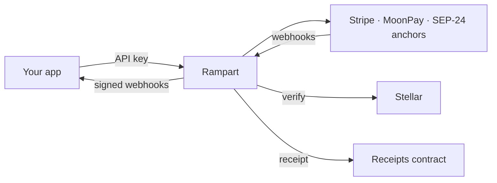

<p align="center">
  
</p>

<h1 align="center">Rampart</h1>

<p align="center">
  <b>Reliable, non-custodial fiat on/off-ramps for Stellar.</b><br>
  One API over Stripe, MoonPay and SEP-24 anchors, with every delivery verified on-chain.
</p>

---

## Why

Ramps break in production the same ways every time: missing trustlines, wrong
memos, lost webhooks, sessions stuck on "pending", and "completed" payments that
never arrived. Rampart handles these so your project doesn't have to.

## Features

- **One API, several providers:** Stripe Crypto Onramp, MoonPay and SEP-24 anchors, with one status lifecycle.
- **Pre-flight checks:** catches unfunded accounts and missing trustlines before the user pays, and returns the fix as a transaction to sign.
- **Never stuck:** a reconciler polls providers, so a missed webhook can't strand a session, and late webhooks can't move it backwards.
- **Verified deliveries:** every "completed" is checked on Stellar: transaction, destination, asset, amount and memo.
- **On-chain receipts:** verified deliveries are recorded in a Soroban contract that anyone can check.
- **Non-custodial:** never holds keys or funds. Wallets sign; Rampart builds and checks.
- **Test mode:** `rk_test_` keys run on a sandbox that simulates real failures.
- **SDK and self-hosting:** a TypeScript SDK for server and browser, and a Docker image.

## How it works



1. Your backend creates a session. Rampart checks the wallet first.
2. The user completes KYC and payment with the provider; the SDK handles each step.
3. Rampart follows the session to the end, verifies the delivery on Stellar,
   records a receipt and notifies your backend.

## Quick start

Requires Node.js 22.12+ and PostgreSQL 14+.

```sh
npm run setup                                  # .env, dependencies, Prisma client
npm run db:migrate
npm run project:create -- --name "My app"      # prints live and test API keys
npm run dev                                    # http://localhost:8080
```

Or with Docker: `docker compose up -d --build`.

```ts
import { RicercaRamp } from "@ricerca/ramp";

const ramp = new RicercaRamp("rk_test_...", { baseUrl: "http://localhost:8080" });
const session = await ramp.sessions.create({
  direction: "ON",
  wallet_address: "G...",
  asset: "USDC",
  fiat_amount: 25,
});
```

## Providers

| Provider | On-ramp | Off-ramp | Assets |
|---|:-:|:-:|---|
| Stripe Crypto Onramp | ✓ | | USDC, XLM |
| MoonPay | ✓ | ✓ | USDC, XLM |
| SEP-24 anchors | ✓ | ✓ | Per anchor |

## Repository

| Path | What |
|---|---|
| `src/` | API, session engine, reconciler, provider adapters, Stellar checks |
| `packages/sdk/` | `@ricerca/ramp` TypeScript SDK ([docs](packages/sdk/README.md)) |
| `contracts/ramp-receipts/` | Soroban receipts contract ([docs](contracts/README.md)) |
| `site/` | Website (React + Vite): `cd site && npm install && npm run dev` |
| `docs/reference.md` | Full reference: API, flows, statuses, data model, security, config |

## Status

- **Built:** pre-flight checks, the provider adapters, the session API, webhooks
  in and out, the reconciler, test mode, the SDK, Docker, and the receipts
  contract (live on testnet).
- **Next:** quote comparison across providers, more providers and anchor
  protocols (Transak, SEP-6, SEP-31), an operator dashboard, and mainnet receipts.

## Compliance

Rampart is non-custodial. KYC, fiat handling and payouts are done by the
licensed providers. Check the rules for your jurisdiction before going live.
