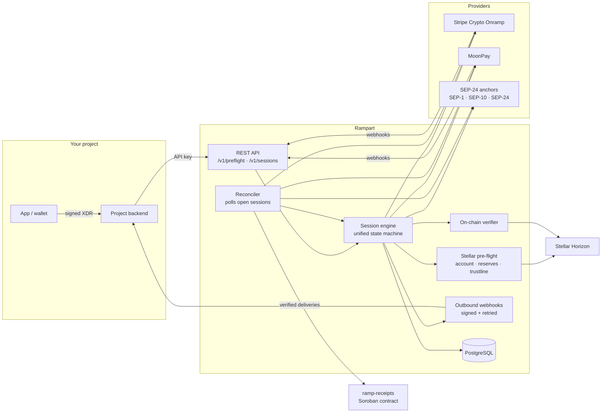
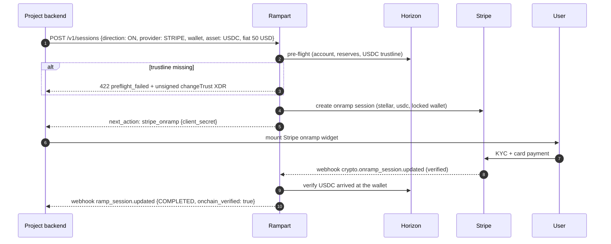
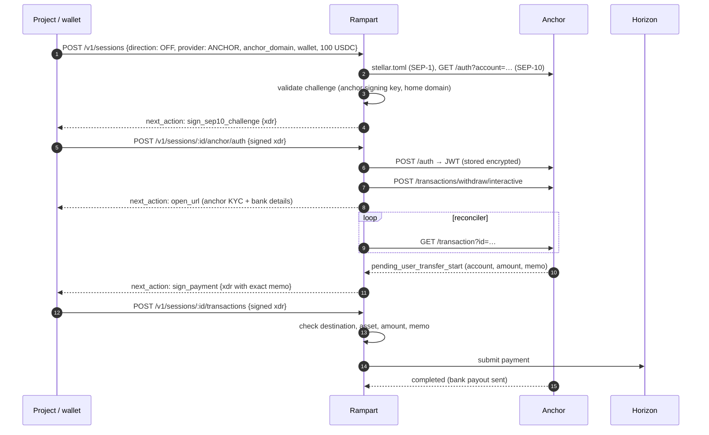
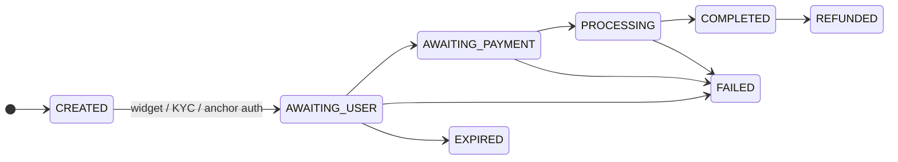
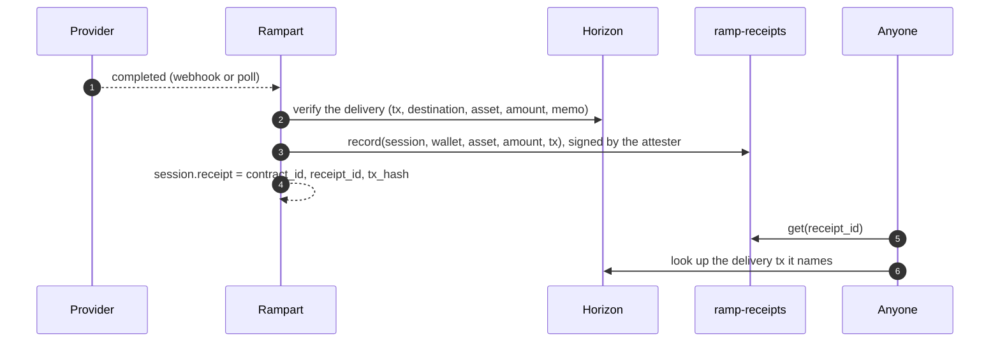
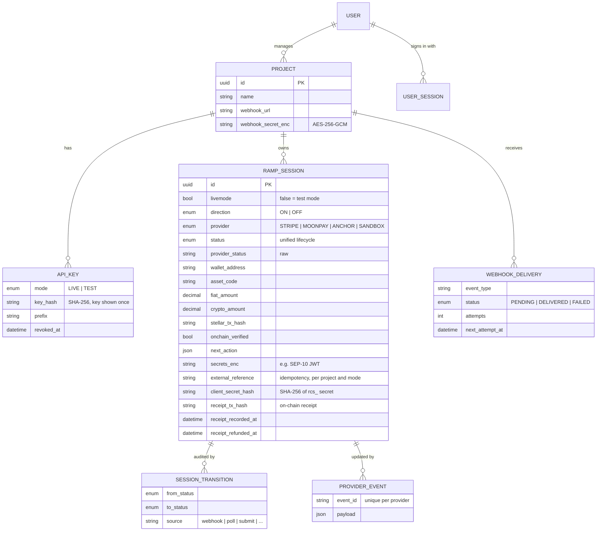

# Rampart: technical reference

The full design and operations guide. For the overview, see the [README](../README.md).

## Contents

- [Why](#why)
- [What it does](#what-it-does)
- [Providers](#providers)
- [Architecture](#architecture)
- [Flows](#flows)
- [Unified session status](#unified-session-status)
- [API design](#api-design)
- [Dashboard and accounts](#dashboard-and-accounts)
- [Test mode and the sandbox](#test-mode-and-the-sandbox)
- [SDK](#sdk)
- [On-chain receipts](#on-chain-receipts)
- [Data model](#data-model)
- [Security](#security)
- [Getting started](#getting-started)
- [Self-hosting with Docker](#self-hosting-with-docker)
- [Scripts](#scripts)
- [Configuration](#configuration)
- [Repository layout](#repository-layout)
- [Roadmap](#roadmap)
- [Compliance note](#compliance-note)

---

## Why

Every project that touches real money on Stellar rebuilds the same fragile
integration, and hits the same failures:

| Failure | What happens | How Rampart handles it |
|---|---|---|
| **No USDC trustline** | The user pays by card, but USDC can't be delivered; the anchor parks it or the onramp fails. | Pre-flight detects it and returns an unsigned `changeTrust` transaction for the wallet to sign **before** payment. |
| **Unfunded account / XLM stuck in reserves** | The account can't hold the trustline or pay fees. | Pre-flight computes the real minimum balance (base reserve × subentries, sponsorships) and reports the shortfall. |
| **Wrong or missing memo on off-ramp** | Funds reach the anchor's pooled account but can't be matched to the user. | The service builds the exact payment (destination, asset, amount, memo) and **refuses to submit** a signed payment that differs. |
| **Status stuck at "pending"** | A webhook was missed and the user never sees completion. | Every session is also polled by a reconciler; the provider's current state wins. |
| **Out-of-order webhooks** | A late "pending" overwrites "completed". | One state machine: webhooks can't move a session backwards, and finished sessions stay finished. |
| **"Completed" but nothing arrived** | Provider says done; the wallet disagrees. | Deliveries are independently verified on Stellar (transaction, destination, asset, amount, memo). |
| **Five providers, five status vocabularies** | Every project maps statuses by hand. | Stripe, MoonPay and SEP-24 statuses map to one lifecycle. |

## What it does

- **One API over several providers:** Stripe Crypto Onramp, SEP-24 anchors and MoonPay.
- **Non-custodial:** it never holds user keys. Wallets sign the SEP-10 challenge, trustlines and withdraw payments; the service builds and checks them.
- **Pre-flight wallet checks** before any money moves.
- **Anchor safety:** it only contacts allow-listed anchors, validates SEP-10 challenges before a wallet signs them, and checks memos on withdrawals.
- **On-chain verification** of every delivery via Horizon, including claimable balances.
- **On-chain receipts:** each verified live delivery can be recorded in a Soroban contract, so anyone can check it without trusting the service.
- **Verified inbound webhooks** (Stripe and MoonPay signatures, timestamp tolerance, deduplication).
- **Signed outbound webhooks** to each project's backend, with retries.
- **Multi-tenant:** each project gets an API key, a webhook endpoint and its own sessions.

## Providers

| Provider | On-ramp | Off-ramp | Assets | Fiat | Integration |
|---|:-:|:-:|---|---|---|
| **Stripe Crypto Onramp** | ✓ | — | USDC, XLM | USD, EUR | `POST /v1/crypto/onramp_sessions` with `destination_network=stellar`; embedded widget via `client_secret`; `crypto.onramp_session.updated` webhooks |
| **SEP-24 anchors** | ✓ | ✓ | USDC (per anchor) | Per anchor | SEP-1 discovery → SEP-10 auth (wallet signs) → SEP-24 interactive deposit/withdraw → `GET /transaction` |
| **MoonPay** | ✓ | ✓ | USDC, XLM | USD, EUR, GBP, … | Signed widget URLs (buy/sell), `externalTransactionId` = session id, `Moonpay-Signature-V2` webhooks |

Notes:
- Stripe's Onramp API is in public preview, needs Stripe approval, and serves US (excluding Hawaii) and EU customers.
- MoonPay requires a **memo** on Stellar deposits. Currency codes (`usdc_xlm`, `xlm`) are configurable; confirm them against your MoonPay account.
- SEP-24 anchors decide their own fiat rails, KYC and limits. `npm run anchor:check` shows what an anchor supports.

## Architecture



## Flows

### On-ramp: card → USDC (Stripe)



### Off-ramp: USDC → bank (SEP-24 anchor)



The same anchor flow handles deposits (on-ramp). The anchor delivers USDC
directly, or as a claimable balance if the trustline is missing.

### MoonPay (buy or sell)

The service returns a **signed** widget URL with `externalTransactionId` set to
the session id. MoonPay webhooks and polling (`/v1/transactions/ext/:id`,
`/v3/sell_transactions/ext/:id`) map straight back to the session.

## Unified session status



| Unified | Stripe | MoonPay | SEP-24 |
|---|---|---|---|
| `AWAITING_USER` | `initialized` | `waitingAuthorization` | `incomplete`, `pending_user`, `pending_trust` |
| `AWAITING_PAYMENT` | `requires_payment` | `waitingPayment`, `waitingForDeposit` | `pending_user_transfer_start` |
| `PROCESSING` | `fulfillment_processing` | `pending` | `pending_user_transfer_complete`, `pending_external`, `pending_anchor`, `pending_stellar` |
| `COMPLETED` | `fulfillment_complete` | `completed` | `completed` |
| `FAILED` | `rejected` | `failed` | `error`, `no_market`, `too_small`, `too_large` |
| `EXPIRED` / `REFUNDED` | — | — | `expired` / `refunded` |

The rules are in [`src/domain/status.ts`](../src/domain/status.ts):

- Terminal states are final, except `COMPLETED → REFUNDED`.
- Webhooks can't move a session backwards.
- Polls can, because some anchors legitimately ask the user for more information.

## API design

Projects authenticate with `Authorization: Bearer <project API key>`. Each
project has a **live** key (`rk_live_...`, real providers) and a **test** key
(`rk_test_...`, [sandbox](#test-mode-and-the-sandbox) only); live and test
sessions never see each other. Amounts are decimal strings.

Creating a session also returns a **client secret** (`rcs_...`). A browser uses
it on the `/v1/client` endpoints to follow that one session and submit wallet
signatures, so the API key never leaves the project's server.

| Method | Path | Purpose | Status |
|---|---|---|---|
| `GET` | `/health` | Liveness | ✅ |
| `GET` | `/v1/providers` | Enabled providers, directions, assets, fiat; test-mode scenarios | ✅ |
| `POST` | `/v1/preflight` | Wallet readiness + unsigned fix-up transactions | ✅ |
| `POST` | `/v1/sessions` | Start a ramp (`direction`, `provider`, `wallet_address`, `asset`, amounts, `external_reference` for idempotency, `sandbox_scenario` in test mode). Returns `client_secret` once | ✅ |
| `GET` | `/v1/sessions/:id` | Status, `next_action`, tx hash, on-chain verification | ✅ |
| `GET` | `/v1/sessions` | List/filter a project's sessions (`status`, `provider`, `wallet_address`, `external_reference`; cursor `starting_after`) | ✅ |
| `GET` | `/v1/sessions/:id/events` | Status history and the provider events received | ✅ |
| `POST` | `/v1/sessions/:id/anchor/auth` | Submit the wallet-signed SEP-10 challenge | ✅ |
| `POST` | `/v1/sessions/:id/transactions` | Submit the wallet-signed withdraw payment | ✅ |
| `POST` | `/v1/sessions/:id/refresh` | Poll the provider now | ✅ |
| `POST` | `/v1/sandbox/sessions/:id/advance` | Test mode: jump to the scenario's next step | ✅ |
| `GET` · `POST` | `/v1/client/sessions/:id` · `.../anchor/auth` · `.../transactions` | Browser endpoints, authenticated with the session's client secret (CORS enabled) | ✅ |
| `POST` | `/webhooks/stripe` · `/webhooks/moonpay` | Inbound provider webhooks (verified, deduplicated) | ✅ |

`next_action` tells the project what the user or wallet has to do next:

| `type` | Meaning |
|---|---|
| `stripe_onramp` | Mount Stripe's widget with `client_secret` |
| `open_url` | Open the provider or anchor URL (MoonPay widget, anchor KYC, more info) |
| `sign_sep10_challenge` | Wallet signs `xdr` to authenticate with the anchor |
| `sign_payment` | Wallet signs the withdraw payment (destination, amount, memo included) |
| `none` | Nothing to do; wait for status updates |

Outbound webhooks (`ramp_session.updated`) are signed with
`Rampart-Signature: t=<unix>,v1=<hex HMAC-SHA256(project secret, "t.body")>`
and retried with backoff (30 s up to 12 h, 9 attempts). The SDK's
`Rampart.webhooks.constructEvent()` verifies them.

## Dashboard and accounts

The site (`site/`) has sign-in, sign-up and a dashboard where users create
projects and manage their API keys. There are two ways in:

1. **Email + password.** Passwords are hashed with scrypt; a wrong password and
   an unknown email get the same answer and take the same time.
2. **Or a Stellar wallet.** The API issues a one-time challenge
   (stateless, HMAC-signed, valid 5 minutes), Freighter signs it with SEP-53
   (no transaction, no fee), and the API verifies the signature against the
   address. The first wallet sign-in creates the account.

Either way the API returns a session token (`rds_...`, 30 days by default)
that the dashboard sends as `Authorization: Bearer`. Only its SHA-256 is
stored, and signing out revokes it.

| Method | Path | Purpose |
|---|---|---|
| `POST` | `/v1/auth/signup` | Create an account (`email`, `password` of 10+ characters) and sign in |
| `POST` | `/v1/auth/login` | Sign in with email and password |
| `POST` | `/v1/auth/wallet/challenge` | Message for the wallet to sign (`address`) |
| `POST` | `/v1/auth/wallet` | Sign in with the signed challenge (`address`, `token`, `signature`) |
| `GET` | `/v1/auth/me` | The signed-in user |
| `POST` | `/v1/auth/logout` | End the session |
| `GET` | `/v1/dashboard/projects` | The user's projects and their keys (prefixes only) |
| `POST` | `/v1/dashboard/projects` | New project (`name`, optional `webhook_url`); returns the live key, test key and webhook secret once |
| `POST` | `/v1/dashboard/projects/:id/keys` | New `live` or `test` key, returned once |
| `DELETE` | `/v1/dashboard/projects/:id/keys/:keyId` | Revoke a key; it stops working immediately |

Projects made with `npm run project:create` have no owner and don't appear in
anyone's dashboard. The site calls the API set in `VITE_RAMPART_API_URL` at
build time (default `http://localhost:8080`).

## Test mode and the sandbox

Every request made with an `rk_test_` key runs on the **SANDBOX** provider:
no cards, no KYC, nothing sent on Stellar. Each session follows a scripted
scenario chosen with `sandbox_scenario`, so a project can prove its
integration handles the failures in [Why](#why) before going live.

| `sandbox_scenario` | What happens |
|---|---|
| `success` (default) | Every step succeeds and every webhook arrives on time |
| `missing_webhooks` | No webhooks; only the reconciler's polling discovers each step |
| `out_of_order_webhooks` | Webhooks arrive newest-first; the stale ones must not move the session backwards |
| `late_webhook` | A stale `PROCESSING` webhook arrives after completion and is ignored |
| `completed_not_delivered` | The provider says `COMPLETED`, nothing arrives: `onchain_verified: false` |
| `kyc_rejected` | Identity check fails: `FAILED` |
| `expired` | The user never finishes: `EXPIRED` |
| `refunded` | `COMPLETED`, then `REFUNDED` |

How it stays honest: polling reports the scenario's true state, as a real
provider's status API would, while its webhooks go through the **same
ingestion path and state machine** as Stripe's and MoonPay's. Off-ramps pause
at `AWAITING_PAYMENT` with a `sign_payment` action; the wallet's signed
payment is checked exactly like an anchor withdrawal (destination, asset,
amount, memo, signature) but never submitted.

Steps advance on their own every `SANDBOX_STEP_SECONDS` (default 3).
`POST /v1/sandbox/sessions/:id/advance` (or `ramp.sandbox.advance()` /
`runToEnd()` in the SDK) skips ahead, which keeps tests fast and deterministic.
Sessions created with a test key may still name a `provider`; it is recorded
as `sandbox.simulating`.

## SDK

[`@rampart/sdk`](../packages/sdk/README.md) (in `packages/sdk`, no runtime dependencies):

- **Server** (`@rampart/sdk`): typed client for every endpoint above, retries for safe requests, `listAll()` pagination, `Rampart.webhooks.constructEvent()`, and sandbox helpers.
- **Browser** (`@rampart/sdk/browser`): `RampRunner` follows a session with its client secret and performs each `next_action`: opens the provider page, mounts Stripe's onramp widget, or has the wallet sign (`stellarWalletsKitSigner` adapts Stellar Wallets Kit: Freighter, xBull, Albedo and others).

```ts
// server
const session = await ramp.sessions.create({ direction: "OFF", provider: "ANCHOR", anchor_domain, wallet_address, crypto_amount: 100 });
// browser
const final = await new RampRunner({ sessionId: session.id, clientSecret, baseUrl, signTransaction }).start();
```

## On-chain receipts

[`contracts/ramp-receipts`](../contracts/README.md) is a Soroban contract that
keeps a public, append-only record of deliveries the service has verified. It
holds no funds and moves none, so the ramp stays non-custodial.



- **What's recorded:** for each live session that is `COMPLETED` and verified on
  Horizon: the wallet, direction, provider, asset (its Stellar Asset Contract
  address), the amount Horizon saw (in stroops) and the delivery transaction.
  The key is the SHA-256 of the session id. Test-mode sessions never touch the chain.
- **Rules the contract enforces:** only attesters the admin added can write; a
  receipt is written once; it can only move from `Delivered` to `Refunded`
  (refunded sessions are marked automatically); one Stellar transaction can
  back only one session's receipt, so a payment can't be claimed twice.
- **How the service uses it:** a reconciler step records receipts and retries
  network errors. A receipt that's already on-chain is adopted, so several
  workers are safe. A permanent refusal (e.g. the tx already backs another
  session) is saved as `receipt_error` and not retried.
- **What projects see:** sessions and `ramp_session.updated` webhooks carry
  `receipt: {contract_id, receipt_id, status, tx_hash, recorded_at, refunded_at}`.
- **Checking one:** `npm run receipt:check -- <contract> <session-id>` reads the
  receipt straight from the contract and confirms its transaction on Horizon.
  It needs no key and no `.env`.

Turn it on with `RECEIPTS_CONTRACT_ID` and `RECEIPTS_ATTESTER_SECRET`; it's off
when they're unset. Testnet deployment: [`CDJK4Y5OLDZJE566HEYRVGBXT4E56EQC2VT6ZP25436M2BX2YRVWKUYT`](https://stellar.expert/explorer/testnet/contract/CDJK4Y5OLDZJE566HEYRVGBXT4E56EQC2VT6ZP25436M2BX2YRVWKUYT).

```text
$ npm run receipt:check -- CDJK4Y5O…WKUYT 44a12070-a5d7-4fa3-9a10-af8dc923c1fc
Status:       DELIVERED
Wallet:       GDMKEHJKZSDTINH5DUYMULJIFRECVA7CJYWXGHWFTP2KYOKTL23TSPYG
Direction:    ON via STRIPE
Amount:       25.5 of asset contract CDLZFC3SYJYDZT7K67VZ75HPJVIEUVNIXF47ZG2FB2RMQQVU2HHGCYSC
Delivery tx:  6f4ff6af43841f7caaa57ce60bfc01dbca33c6eab3fa45835cdecdcf72304975
Recorded:     2026-10-19T08:49:32.000Z by GACZV7NOIP7KGN3QPAVC3NOTML6K4T7QKUCNY4QQOAVEXZDYCMJUDOBY
✓ Delivery transaction succeeded in ledger 5275234.
```

## Data model

Defined in [`prisma/schema.prisma`](../prisma/schema.prisma).



## Security

- **No user keys, ever.** Wallets sign; the service builds unsigned XDR and validates what comes back.
- **Anchor allowlist.** Only domains in `ANCHOR_DOMAINS` are contacted, over HTTPS, which prevents SSRF.
- **Webhook targets.** Webhook URLs must be public https URLs. Private, loopback and link-local addresses (including cloud metadata at `169.254.169.254`) are refused when the URL is saved and again before every delivery, after resolving the hostname. Redirects are not followed. `localhost` is allowed only with `NODE_ENV=development`.
- **SEP-10 validation.** A challenge is checked against the anchor's `SIGNING_KEY` and home domain before the wallet sees it, and the signed challenge must be the one issued for that session.
- **Webhook verification.** Stripe (`Stripe-Signature`, `v1`) and MoonPay (`Moonpay-Signature-V2`) signatures are HMAC-SHA256 with constant-time comparison and a 5-minute timestamp window. Events are deduplicated by provider event id.
- **Secrets at rest.** SEP-10 tokens and project webhook secrets are AES-256-GCM encrypted (`ENCRYPTION_KEY`); API keys and session client secrets are stored as SHA-256 hashes.
- **Scoped browser access.** A session's client secret can read that one session and submit wallet signatures for it, nothing else. An unknown secret and another session's id return the same 404.
- **Test mode is isolated.** `rk_test_` keys only ever reach the sandbox, and live and test sessions are invisible to each other.
- **Dashboard sign-in.** Passwords are scrypt-hashed and session tokens stored as SHA-256. Wallet sign-in needs a SEP-53 signature of a one-time, server-signed challenge, so an address alone never opens an account. Sign-in endpoints have their own per-IP limit (10 a minute by default). Users only ever see and change their own projects.
- **Abuse limits.** Requests are rate-limited per API key, client secret or IP; return URLs must be https; responses carry `nosniff`, `no-referrer` and frame-deny headers, and the sandbox page a strict CSP.
- **Signed URLs.** MoonPay widget URLs are signed server-side, so wallet addresses and amounts can't be tampered with.
- **Receipts contract.** The attester key can only write receipts (no funds, no transfers). The admin adds and removes attesters, and changing the admin needs both the old and the new account's signature.

## Getting started

Prerequisites: Node.js **22.12+** and PostgreSQL **14+**.

```sh
npm run setup          # .env with a fresh ENCRYPTION_KEY, install, Prisma client
# edit .env: DATABASE_URL, provider keys
npm run db:migrate     # create tables
npm run project:create -- --name "My app" --webhook-url https://my-app.example/hooks/ramp
npm run dev            # http://localhost:8080/health (also runs the worker)
```

`project:create` prints a live key, a test key and a webhook secret once (or
sign up in the [dashboard](#dashboard-and-accounts) and create the project
there). Try the sandbox straight away:

```sh
curl -s localhost:8080/v1/sessions -H "Authorization: Bearer rk_test_..." \
  -H "Content-Type: application/json" \
  -d '{"direction":"ON","wallet_address":"G...","fiat_amount":25,"sandbox_scenario":"late_webhook"}'
```

## Self-hosting with Docker

```sh
npm run setup                    # creates .env with ENCRYPTION_KEY (fill in provider keys)
docker compose up -d --build     # Postgres, migrations, API on :8080, worker
docker compose run --rm api node dist/cli/project-create.js --name "My app"
```

The image runs the API by default (`node dist/main.js`) or the worker
(`node dist/worker.js`). In compose they are separate containers
(`WORKER_IN_PROCESS=false`); several workers can run at once because
webhook deliveries are claimed atomically.

### Hosting the API on Vercel

The hosted API (`https://rampart-api.vercel.app`) runs on Vercel with a Neon
Postgres database, both on free plans:

- `api/index.js` is the function; `vercel.json` sends every path to it. The
  build ([`scripts/vercel-build.sh`](../scripts/vercel-build.sh)) bundles
  `src/vercel.ts` with esbuild and, on production deploys only, runs
  `prisma migrate deploy` over Neon's unpooled connection.
- Environment: `DATABASE_URL` and `DATABASE_URL_UNPOOLED` (set by the Neon
  integration), `ENCRYPTION_KEY`, `PUBLIC_BASE_URL`, `TRUST_PROXY=true`,
  `WORKER_IN_PROCESS=false` and `NODEJS_HELPERS=0`. The site's Vercel project
  sets `VITE_RAMPART_API_URL` to the API's URL.
- Only the HTTP API runs there. The reconciler and outbound webhook retries
  need a long-running `npm run worker` (the Docker image, for example) pointed
  at the same database.

## Scripts

| Command | What it does |
|---|---|
| `npm run setup` | First-time setup: `.env` with a generated `ENCRYPTION_KEY`, dependencies, Prisma client |
| `npm run dev` | Start the API with reload (runs the worker in-process) |
| `npm run build` / `npm start` | Production build and run |
| `npm run worker` / `npm run dev:worker` | Run the reconciler and webhook delivery as a separate process |
| `npm run project:create -- --name ... [--webhook-url ...]` | Create a project with live and test keys and a webhook secret |
| `npm run typecheck` / `npm test` | TypeScript check / tests (integration tests use `TEST_DATABASE_URL`, or start an embedded Postgres if unset) |
| `npm run sdk:build` / `npm run sdk:test` | Build / test the SDK |
| `npm run db:migrate` | Apply database migrations |
| `npm run preflight -- <G…> [USDC\|XLM] [ON\|OFF] [amount]` | Check whether a wallet can ramp; prints the trustline transaction to sign if one is missing |
| `npm run anchor:check -- <domain>` | Verify an anchor's SEP-1/10/24 setup and list its deposit/withdraw assets and limits |
| `npm run receipt:check -- <C…> <session-id> [TESTNET\|PUBLIC]` | Read a session's on-chain receipt and confirm its delivery transaction (no key needed) |
| `cd contracts && cargo test` | Contract tests (`stellar contract build` for the WASM) |

Example on testnet:

```text
$ npm run preflight -- GC2ITVMY…MPGLNO USDC ON 25
XLM:     9998.8780074 (minimum 1.5000000, spendable 9997.8780074)
✗ Not ready:
  - [missing_trustline] The account has no trustline for USDC, so USDC cannot be delivered to it.
    Sign and submit this XDR to add the trustline: AAAAAgAAAAC0idWY…

$ npm run anchor:check -- testanchor.stellar.org
SEP-10 auth:     https://testanchor.stellar.org/auth
SEP-24 server:   https://testanchor.stellar.org/sep24
deposit          SRT (1–10), native (1–10), USDC (1–10)
withdraw         SRT (1–10), native (1–10), USDC (1–10)
```

## Configuration

All settings are environment variables validated at startup ([`src/config.ts`](../src/config.ts)); see [`.env.example`](../.env.example).

| Variable | Required | Purpose |
|---|---|---|
| `DATABASE_URL` | yes | PostgreSQL |
| `ENCRYPTION_KEY` | yes | 32-byte base64 key for secrets at rest |
| `STELLAR_NETWORK` | | `TESTNET` (default) or `PUBLIC` |
| `HORIZON_URL`, `USDC_ISSUER` | | Overrides; default to SDF Horizon and Circle's issuer |
| `STRIPE_SECRET_KEY`, `STRIPE_WEBHOOK_SECRET` | for Stripe | Onramp API + webhook signing secret |
| `MOONPAY_PUBLISHABLE_KEY`, `MOONPAY_SECRET_KEY`, `MOONPAY_WEBHOOK_KEY` | for MoonPay | Widget, URL signing, webhook verification |
| `MOONPAY_BUY_URL`, `MOONPAY_SELL_URL` | | Sandbox by default |
| `MOONPAY_CURRENCY_USDC`, `MOONPAY_CURRENCY_XLM` | | MoonPay currency codes for Stellar assets |
| `ANCHOR_DOMAINS` | for anchors | Comma-separated allowlist (default `testanchor.stellar.org`) |
| `SESSION_TTL_MINUTES`, `RECONCILE_INTERVAL_SECONDS` | | Session expiry and polling cadence |
| `SANDBOX_ENABLED`, `SANDBOX_STEP_SECONDS` | | Test mode on/off (default on) and the sandbox's step length |
| `WORKER_IN_PROCESS` | | Run the reconciler inside the API (default `true`; `false` with a separate worker) |
| `RECEIPTS_CONTRACT_ID`, `RECEIPTS_ATTESTER_SECRET` | for receipts | Record verified deliveries on-chain; set both or neither |
| `RATE_LIMIT_PER_MINUTE` | | Requests per minute per API key, client secret or IP (default 300, `0` = off); health checks and provider webhooks are exempt |
| `AUTH_RATE_LIMIT_PER_MINUTE` | | Sign-up, sign-in and wallet-challenge requests per minute per IP (default 10, `0` = off) |
| `USER_SESSION_DAYS` | | How long a dashboard sign-in lasts (default 30) |
| `TRUST_PROXY` | | `true` behind a reverse proxy, so client IPs come from `X-Forwarded-For` |
| `SOROBAN_RPC_URL` | | Soroban RPC override; defaults to SDF's testnet RPC (or a mainnet RPC on `PUBLIC`) |

## Repository layout

```text
.
├── Dockerfile · docker-compose.yml
├── contracts/ramp-receipts/    # Soroban contract: on-chain receipts of verified deliveries
├── prisma/schema.prisma        # projects, API keys, users, sessions, transitions, provider events, webhook deliveries
├── packages/sdk/               # @rampart/sdk: server client, webhook verification, browser runner
├── scripts/
│   ├── setup.sh                # first-time setup
│   ├── preflight.ts            # wallet readiness CLI
│   ├── check-anchor.ts         # anchor capability CLI
│   └── check-receipt.ts        # read a receipt from the contract (no key)
├── test/                       # sandbox unit tests, API and SDK end-to-end tests
└── src/
    ├── main.ts · app.ts        # HTTP server and routes
    ├── worker.ts               # standalone reconciler / webhook worker
    ├── cli/project-create.ts   # create a project and its keys
    ├── config.ts               # validated environment
    ├── domain/status.ts        # unified lifecycle + provider status mappings
    ├── engine/
    │   ├── sessions.ts         # create, apply updates (state machine), verify, actions
    │   ├── inbound.ts          # provider webhook ingestion + deduplication
    │   ├── outbound.ts         # signed webhooks to projects, retries
    │   ├── reconciler.ts       # polling, expiry, verification retries, sandbox
    │   ├── receipts.ts         # record / refund on-chain receipts
    │   └── serialize.ts        # public JSON shapes
    ├── http/                   # API key / client secret auth, sandbox checkout page
    ├── providers/
    │   ├── types.ts            # RampProvider interface, next_action types
    │   ├── stripe.ts           # Stripe Crypto Onramp (+ webhook verification)
    │   ├── moonpay.ts          # MoonPay buy/sell (URL signing + webhook verification)
    │   ├── anchor.ts           # SEP-1/10/24 (challenge validation, withdraw payment checks)
    │   ├── sandbox.ts          # simulated provider for test mode
    │   └── registry.ts
    ├── stellar/
    │   ├── network.ts          # network, Horizon, USDC issuers
    │   ├── horizon.ts          # minimal Horizon client
    │   ├── preflight.ts        # account, reserves, trustline checks
    │   ├── verify.ts           # on-chain delivery verification
    │   └── receipts.ts         # Soroban client for the receipts contract
    └── lib/                    # crypto (AES-GCM, HMAC), errors, db
```

## Roadmap

**Phase 1: foundation (this scaffold)**
- [x] Data model and migrations setup
- [x] Validated configuration
- [x] Stellar pre-flight (account, reserves, trustline) with unsigned fix-up XDR
- [x] On-chain delivery verification (payments, path payments, claimable balances, memo)
- [x] Unified status model and transition rules
- [x] Provider adapters: Stripe onramp, MoonPay buy/sell, SEP-24 anchors
- [x] Webhook signature verification (Stripe, MoonPay)
- [x] Setup, pre-flight and anchor-check scripts

**Phase 2: session API, test mode and SDK**
- [x] Project API keys, live and test (`project:create` CLI), and auth
- [x] `/v1/preflight` and `/v1/sessions` routes with idempotency (`external_reference`)
- [x] Anchor auth + withdraw payment routes, and browser (`/v1/client`) routes with per-session client secrets
- [x] Inbound webhook routes with event deduplication
- [x] Outbound signed webhooks with exponential backoff
- [x] Reconciler worker (poll open sessions, expire stale ones, retry verification)
- [x] Sandbox provider with failure scenarios (test mode)
- [x] `@rampart/sdk` SDK: server client, webhook verification, browser `next_action` runner
- [x] Dashboard: email + password or Freighter wallet sign-in, projects and API keys
- [x] Docker image and docker-compose for self-hosting
- [x] Unit, integration and SDK end-to-end tests; CI
- [x] `ramp-receipts` Soroban contract: on-chain receipts of verified deliveries (testnet)
- [ ] React component on top of the browser runner
- [ ] Sponsored reserves and fee bumps for unfunded wallets

**Phase 3: production**
- [ ] Quote comparison across providers (Stripe quotes, MoonPay quotes, SEP-38)
- [ ] Transak adapter
- [ ] SEP-6 (non-interactive) and SEP-31 (cross-border) anchors
- [ ] Dashboard for project operators (sessions, failures, delivery logs)
- [ ] Metrics and alerting on stuck sessions
- [ ] Receipts contract on mainnet, with the admin on a multisig

## Compliance note

Rampart is designed to be **non-custodial**: fiat handling, KYC/AML and
payouts are performed by the licensed providers (Stripe, MoonPay, anchors),
and the service never holds user funds or keys. Confirm the regulatory
position for your jurisdictions and use case with counsel before going live.
